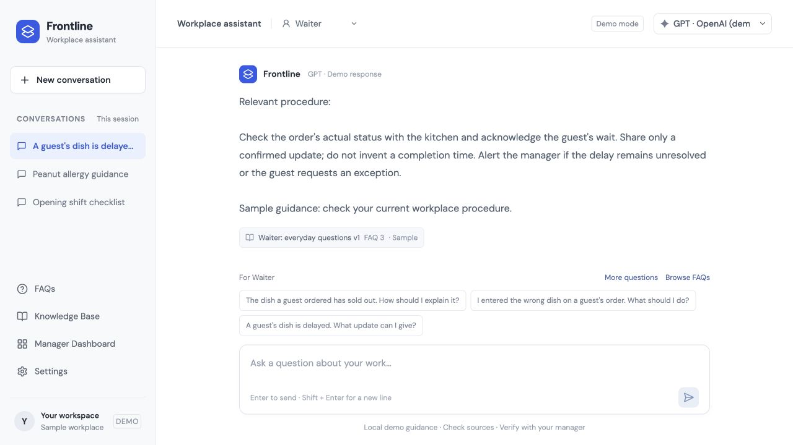
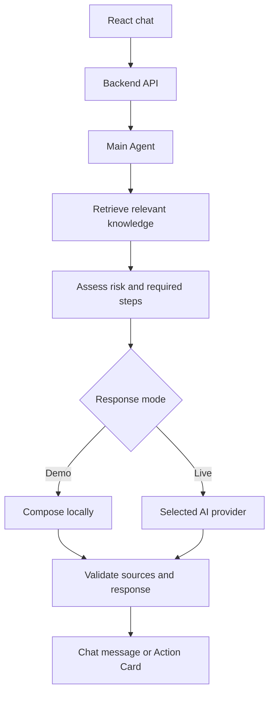

# Frontline Workplace Knowledge Agent

A conversation-first workplace assistant for small and medium-sized businesses. Frontline helps staff find relevant procedures, follow clear next steps, and recognise when a situation needs manager help.

The prototype supports **Cashier**, **Waiter**, and **Kitchen Staff** roles. It combines company-knowledge retrieval, fixed risk checks, and a replaceable AI provider layer in a small TypeScript codebase.

> **Prototype status:** Demo mode works without API keys and composes responses locally. Live provider adapters are implemented, but real model responses remain unverified. Included policies and FAQs are fictional samples.



## What it does

- **Role-specific guidance:** questions and relevant procedures change with the selected role.
- **Action Cards:** recognised risk cases show a risk level, situation summary, recommended actions, sources, and manager-help controls.
- **Source viewing:** open the exact retrieved procedure excerpt and its version.
- **FAQs and Knowledge Base:** browse 36 built-in sample FAQs, with 12 for each role, alongside shared procedures.
- **Question review:** submit a question, review it in Manager Dashboard, and publish a reusable sample answer with a reference and review date.
- **Model selection:** use the same interface with OpenAI, Anthropic, DeepSeek, or Kimi adapters.
- **Manager handover:** prepare an editable draft or open the contact panel. Demo contact links are disabled; the app sends no notification automatically.

## Quick start

**Requirements:** Node.js 24 and npm. Local FAQ storage uses Node's built-in `node:sqlite` module.

```sh
git clone https://github.com/Kenkencs/workplace-agent.git
cd workplace-agent
npm ci
npm run dev
```

Open the frontend URL printed in the terminal, normally **http://127.0.0.1:5173**. The command starts both Vite and the Node backend. Press `Ctrl+C` to stop them.

Select a model labelled **demo**. No `.env` file or paid AI request is needed for the demo.

### Try these questions

| Role | Question | What to look for |
| --- | --- | --- |
| Waiter | A guest's dish is delayed. What update can I give? | An ordinary reply with a relevant source |
| Waiter | Customer says she has a severe peanut allergy. Can she eat this cake? | A high-risk Action Card with conservative steps |
| Cashier | The receipt printer is not printing. What should I do? | Receipt-specific checks and a Cashier FAQ source |
| Cashier | Can I refund this customer? | Policy and approval checks rather than permission to refund |

You can also open **FAQs**, submit a question, review it in **Manager Dashboard**, and find the published answer in **Knowledge Base** and later chat retrieval. Published answers remain sample evidence.

## Architecture



The **1+2 agent workflow** consists of three cooperating code components:

| Component | Responsibility |
| --- | --- |
| Main Agent | Coordinates retrieval, risk assessment, response generation, and final validation |
| Knowledge Agent | Finds matching excerpts using role, policy version, approval status, and review date |
| Risk Agent | Applies fixed checks for known hazards, permission questions, and escalation |

These are software modules rather than three independent AI models. Demo mode makes no model call. Live mode uses one structured-generation request per question.

### Technical choices

- **Keyword-based RAG:** the live path supplies the question, role, retrieved excerpts, and risk assessment to the selected model. Retrieval returns at most four excerpts; it uses no embeddings or vector database.
- **Structured output:** a shared JSON contract gives every provider the same message and Action Card fields. The backend validates the result at runtime.
- **Application checks:** citations must match retrieved records. Known risk cases keep application-owned required steps; a model cannot replace them with a food-safety guarantee or refund approval.
- **Replaceable providers:** `AIProvider` defines `generate()`, `structuredGenerate()`, and `stream()`. The chat endpoint uses completed structured responses; it does not stream partial cards.
- **Backend-only keys:** the frontend calls the application API, never a model provider directly.

See the [architecture walkthrough](docs/ARCHITECTURE.md) for the full request flow and design limits.

## Technology stack

| Layer | Tools |
| --- | --- |
| Frontend | React, TypeScript, Vite, CSS |
| Backend | Node.js for local development; a Worker adapter for hosting |
| Knowledge and risk | Local keyword retrieval, version filtering, deterministic risk rules |
| AI integration | Native HTTP adapters behind one `AIProvider` interface |
| FAQ storage | SQLite locally; D1 through the hosted adapter |
| Schema and checks | Drizzle migrations, TypeScript, Node's test runner |

The project uses no LangChain, LangGraph, or provider SDK. The small workflow is implemented directly in TypeScript to keep it easy to read and modify.

## Optional live provider setup

Copy `.env.example` to `.env` and add only the backend keys you need:

```sh
cp .env.example .env
```

```dotenv
OPENAI_API_KEY=
ANTHROPIC_API_KEY=
DEEPSEEK_API_KEY=
KIMI_API_KEY=
```

| Provider | Configured model ID | Backend variable |
| --- | --- | --- |
| OpenAI | `gpt-4.1-mini` | `OPENAI_API_KEY` |
| Anthropic | `claude-haiku-4-5-20251001` | `ANTHROPIC_API_KEY` |
| DeepSeek | `deepseek-flash` | `DEEPSEEK_API_KEY` |
| Kimi | `kimi-k2.6` | `KIMI_API_KEY` |

Restart the backend after changing `.env`, then choose the corresponding **live** model. Model choices are allowlisted in [`shared/catalog.ts`](shared/catalog.ts). The Kimi adapter uses the global `api.moonshot.ai` endpoint and requires a corresponding key.

Live requests may incur provider charges and send the current question, role, retrieved text, and risk assessment to the selected provider. Account access, current model compatibility, and real outputs still need verification. A failed live request stays an error; it never silently becomes a demo response or switches providers.

**Never commit `.env`, put keys in React, or prefix secret variables with `VITE_`.** Hosted deployments need backend runtime secrets rather than a copy of the local `.env` file.

## Common chat API

The frontend uses one endpoint regardless of provider:

```http
POST /api/chat
Content-Type: application/json
```

```json
{
  "message": "Customer says she has a severe peanut allergy. Can she eat this cake?",
  "employee_role": "waiter",
  "provider": "openai",
  "model": "demo-gpt"
}
```

A successful response is either an ordinary message with `content` and `sources`, or an Action Card with `risk`, `summary`, `actions`, `sources`, `confidence`, and `escalate`. Both include a `type` field.

Additional routes provide the knowledge catalog, FAQs, question review, and manager contact configuration. See [API and persistence details](docs/ARCHITECTURE.md).

## Run checks and preview

```sh
npm test
npm run typecheck
npm run build
npm run preview
```

Preview starts the frontend and backend, normally at **http://127.0.0.1:4173**. Production output includes React assets and a Worker entry point.

The latest recorded verification, **11 October 2026**, passed **142 automated tests**, TypeScript checks, and the production build. Provider tests use fake upstream responses. They do not establish live model accuracy, workplace safety, or results from staff trials. See the [verification record](docs/VERIFICATION.md).

## Project structure

```text
src/                  Chat interface, workspace pages, and API clients
shared/               Request/response types and runtime validation
server/agents/        Main Agent and risk rules
server/knowledge/     Sample procedures, role FAQs, and retrieval
server/providers/     Common provider interface and four adapters
server/faq/           Persistent question review and reusable answers
db/ and drizzle/      FAQ database schema and generated migrations
tests/                API, provider, retrieval, risk, and storage checks
docs/                 Architecture and verification records
```

To change sample procedures, edit [`server/knowledge/documents.ts`](server/knowledge/documents.ts) and [`roleDocuments.ts`](server/knowledge/roleDocuments.ts). To change risk rules, start with [`riskAgent.ts`](server/agents/riskAgent.ts). Public manager-contact configuration lives in [`server/workplace.ts`](server/workplace.ts).

## Data and prototype limits

- All supplied procedures and FAQs are fictional. Their approval labels demonstrate version handling; they do not prove real company approval or product safety.
- Keyword retrieval and risk patterns can miss unfamiliar wording. A low-risk label is not a safety guarantee. Sample or missing evidence limits Action Card confidence to low.
- Role selection provides answer context, not authenticated identity. The prototype has no separate employee/manager permissions; add server-side authorization before sharing the review workflow with staff.
- Conversations and handover drafts stay in browser memory and reset on reload. Explicitly submitted FAQ questions and review decisions persist in the database.
- Local records live in ignored `.data/frontline.sqlite`. Hosted and local records are separate. There are no document uploads, delivered manager notifications, or streaming chat UI.
- Manager contact details are fake and inactive. Real configuration can open a validated phone or HTTPS contact link; it cannot confirm that a manager received or answered the request.

The goal is a clear, maintainable workplace prototype that a student developer can understand and extend.
